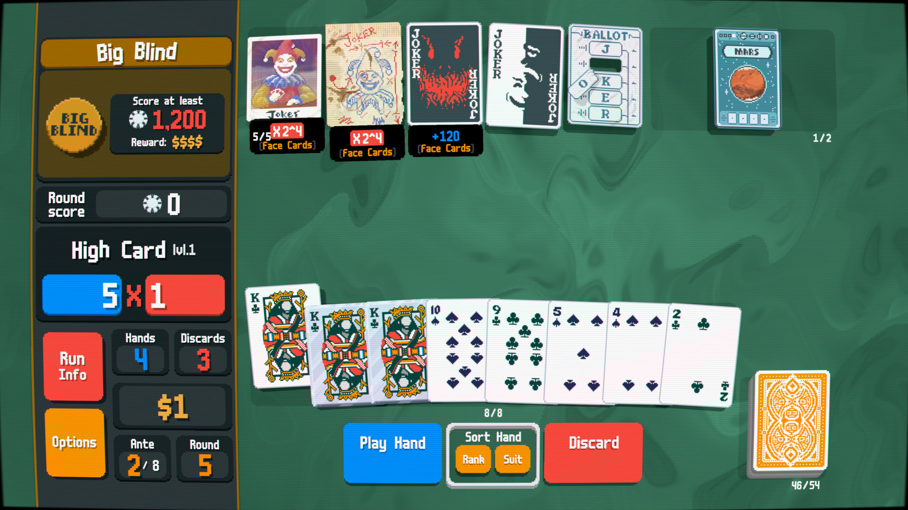
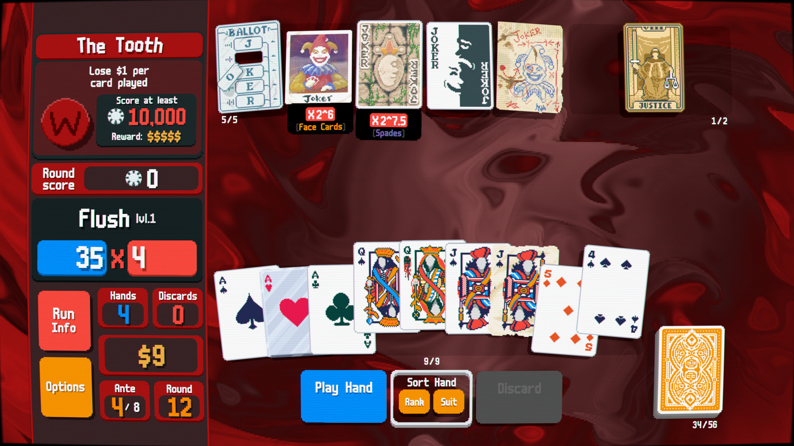
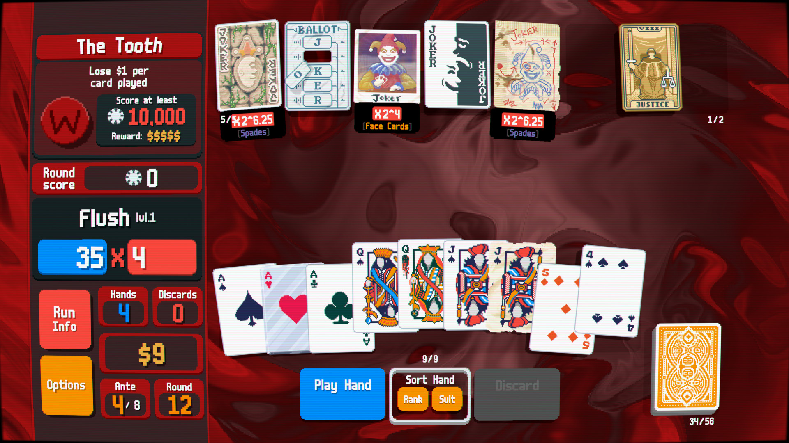
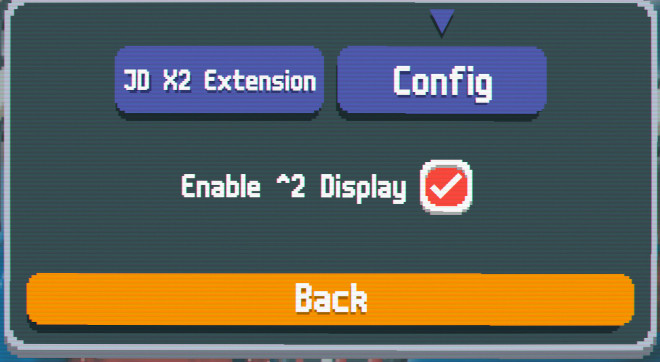

# Joker Display X2 Mod

A Joker Display extension mod that changes XMULT to showing the power of 2. I made this because of MLBA commentators talking about how it can be easier to count how many *2s there are in triggers rather than the full xmult value. FIgured this could help someone get used to thinking that way.

Since JokerDisplay is already what people use and does a pretty good job, this mod just makes a small change to it in order to use the X2 display.

## Pre-requisites

Steamodded: https://docs.smods.dev/Installation/
Joker Display: https://github.com/nh6574/JokerDisplay#installation

## Installation

1. Install the pre-requisites
2. Download the latest release form this repo
3. Extract the release and make it into a folder in your Balatro mods folder (%appdata%\Balatro\Mods)

## Usage

Enable from the mod configuration settings.
Whenever a Joker has an XMULT of at least 2, it will be replaced by it's approximate log2 value. In order to avoid confusing fractions, it will display to the nearest 0.25. So 3 XMULT becomes X2^1.5 as an example.

Examples:

```
X2->X2^1
X4->X2^2
X1024->X2^10
X3->X1.5
```

Screenshots:








